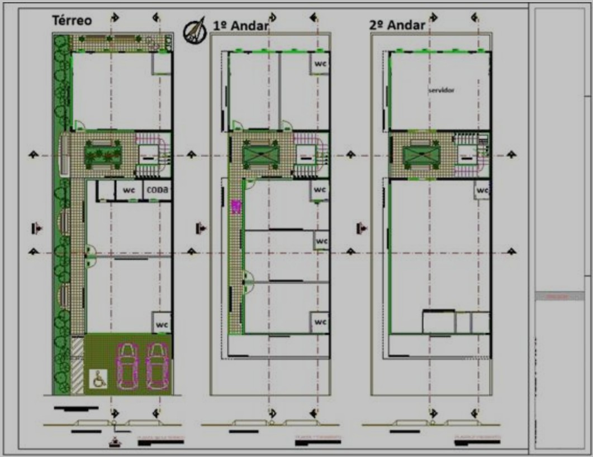
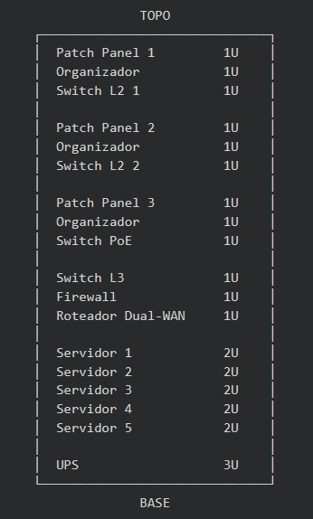

# **Projeto de Rede Estruturada - TechSolutions**

---

## **01 - Levantamento de Requisitos**

### **1.1 Perfil da Empresa**

A empresa é situada em um prédio de três andares, sendo: térreo, 1º andar, 2º andar.

### **1.2 Ambientes por Andar**

#### **Térreo – Recepção, Vivência e Sala de Reuniões**

- 16 dispositivos

  - Recepção:  1 AP, 1 impressora de rede, 1 televisão, 2 computadores e 1 ar-condicionado.

  - Sala de reuniões: 1 AP, 1 computador, 1 projetor multimídia e 1 ar-condicionado.

  - Vivência: 1 AP, 1 televisão, 1 videogame e 3 aparelhos de ar-condicionado.

#### **1º andar – 3 Salas de Desenvolvimento, 1 Sala de Suporte, 1 Sala do Administrativo**

- 52 dispositivos

  - Desenvolvimento: 3 APs, 3 aparelhos de ar-condicionado, 24 computadores, 1 impressora de rede.

  - Suporte: 1 AP, 1 ar-condicionado, 8 computadores e 1 impressora de rede.

  - Administrativo: 1 AP, 1 ar-condicionado, 7 computadores e 1 impressora de rede.

#### **2º andar – Sala da Diretoria e Sala de Servidores**

- 16 dispositivos

  - Diretoria: 1 AP, 2 aparelhos de ar-condicionado, 2 computadores, 2 impressoras de rede, 1 televisão.

  - Sala de Servidores: 1 AP, 2 aparelhos de ar-condicionado e 5 servidores (aplicações, banco de dados, backup, arquivos e web).

#### **Infraestrutura Adicional**

- 182 dispositivos

  - 32 câmeras IP (distribuídas pelo prédio)

  - Rede de visitantes Wi-Fi com até 50 dispositivos simultâneos

  - Rede de funcionários Wi-Fi com até 100 dispositivos simultâneos.

*OBS: O térreo, diferente dos demais andares, possui tanto uma área de circulação de clientes, como também uma área de acesso restrito. Enquanto o 1º e 2º andar são áreas de acesso restrito.*

### **1.3 Quantidade de Dispositivos**

- Térreo: 16 hosts

- 1º andar: 52 hosts

- 2º andar: 16 hosts

- Infraestrutura adicional: 182 hosts

- **Total: 266 hosts**

*OBS: Esse valor representa a capacidade máxima considerada para o dimensionamento da rede, não a quantidade de dispositivos fixos da empresa.*

### **1.4 Planta da Empresa**

### **1.5 Necessidades de Segurança**

Quando falamos de segurança, o primeiro "ativo" que precisa ser protegido da empresa são as pessoas. Contudo, como não é o foco deste projeto levar para o âmbito da gestão de pessoas, este assunto não será abordado.

Por outro lado, para garantir a segurança dos ativos é necessário tomar medidas para proteger tanto os ativos tangíveis (dispositivos, equipamentos), como também os ativos intangíveis (propriedade intelectual, dados pessoais sensíveis, reputação).

Os três pilares da segurança da informação: confidencialidade, integridade e disponibilidade (CID), serão utilizados como referência para identificar os principais objetivos de segurança deste projeto.

#### **Controle de acesso**

Seguindo o princípio de Least Privilege, a rede deverá restringir o acesso dos usuários e dispositivos aos recursos necessários para suas respectivas funções.

#### **Segmentação**

Devido à existência de diferentes tipos de dispositivos e níveis de exposição, a rede deverá permitir a separação entre usuários, servidores, câmeras, gerenciamento e convidados.

#### **Isolamento da rede de convidados**

Dispositivos conectados à rede de convidados não deverão possuir acesso aos recursos internos da empresa. Esta é uma superfície de ataque que está mais exposta a ataques, logo deve ser isolada do restante da rede.

#### **Proteção dos servidores**

Os servidores deverão possuir acesso restrito, especialmente aqueles que armazenam dados ou prestam serviços críticos.

#### **Proteção do serviço Web**

Como o servidor Web pode estar exposto à Internet, deverá existir uma forma de isolá-lo da rede interna. Introduziremos não apenas o conceito de VLAN, como também de DMZ, firewall e WAF.

#### **Disponibilidade**

A infraestrutura deverá possuir mecanismos que reduzam o impacto de falhas de equipamentos, energia ou perda de dados. A disponibilidade é um dos pilares da segurança da informação, logo a queda na disponibilidade precisa ser mínima ou, preferencialmente, imperceptível.

#### **Proteção física**

Os equipamentos de rede e servidores deverão permanecer em ambiente protegido contra acesso físico não autorizado e condições ambientais inadequadas. Uma das decisões de arquitetura que pode passar despercebida foi a de definir a sala de servidores no último andar, mas existe uma ideia muito importante por trás. O térreo contém um fluxo de pessoas externas diário, então distanciar os servidores é uma decisão de proteção física importante.

---

## **02 - Premissas do Projeto**

As premissas a seguir estabelecem as condições e estimativas adotadas para o desenvolvimento do projeto, considerando que algumas informações necessárias para o dimensionamento da infraestrutura não foram fornecidas no cenário apresentado.

### **2.1 Premissas Físicas**

As dimensões dos andares serão estimadas a partir da planta fornecida, utilizando o veículo representado no desenho como referência de escala.

Será considerado que os três andares possuem dimensões semelhantes às apresentadas na planta. O posicionamento dos equipamentos de rede será definido posteriormente, buscando manter as distâncias de cabeamento dentro dos limites estabelecidos para o padrão de cabeamento adotado.

Há apenas uma sala de servidores localizada no último andar, conforme apresentado na planta. Assim, será adotada essa localização, contanto que o dimensionamento do cabeamento permita atender aos demais ambientes de forma adequada.

### **2.2 Premissas de Capacidade**

O dimensionamento da infraestrutura não será realizado considerando apenas a quantidade atual de dispositivos. Será prevista uma margem de capacidade para permitir futuras expansões da empresa sem a necessidade de uma reformulação imediata da infraestrutura de rede.

Essa margem será considerada no dimensionamento das sub-redes, equipamentos e demais componentes da infraestrutura quando necessário e tecnicamente justificável.

### **2.3 Premissas Financeiras**

Para fins de desenvolvimento do projeto, será estabelecido um orçamento máximo fictício para a implantação da infraestrutura de rede. O custo real do projeto será calculado posteriormente, com base nos equipamentos, materiais, serviços e mão de obra necessários.

Também será estabelecido um custo mensal estimado para a manutenção da infraestrutura de rede. O modelo de contratação responsável pela manutenção, seja por equipe interna ou por empresa especializada, será definido posteriormente.

### **2.4 Premissas decorrentes da ausência de informações**

Como o cenário apresentado não fornece informações detalhadas sobre dimensões exatas, posicionamento dos equipamentos, infraestrutura elétrica existente, características construtivas do prédio e outros aspectos necessários para um projeto mais realista, serão adotadas estimativas técnicas quando necessário.

Essas estimativas serão identificadas ao longo do projeto e poderão ser revisadas caso informações mais precisas estejam disponíveis em uma etapa posterior de levantamento técnico.

### **2.5 Critérios para tomada de decisão**

As decisões de arquitetura deverão buscar um equilíbrio entre segurança, disponibilidade, capacidade de expansão e custo de implantação e manutenção.

As soluções adotadas deverão priorizar os riscos que possam causar maior impacto à operação da empresa, considerando as necessidades identificadas e limitações orçamentárias fictícias.

---

## **03 - Arquitetura de Rede**

### **3.1 VLSM e Endereçamento IP**

Após análise, verificou-se que o bloco 192.168.0.0/24 não possui quantidade suficiente de endereços para atender à segmentação da rede em VLANs e às respectivas sub-redes. Dessa forma, foi adotado o bloco 192.168.0.0/23, permitindo maior disponibilidade de endereços e viabilizando a implementação da segmentação lógica proposta.

- IP da Rede/CIDR: 192.168.0.0/23

- Endereços Válidos: 192.168.0.1 - 192.168.1.254

“Um aspecto que foi levado em consideração, mas não incluído como endereço adicional nos cálculos, é o endereço IP do gateway de cada sub-rede. Como o gateway utiliza um dos endereços válidos da própria sub-rede, foi considerada a margem de expansão disponível para sua designação.”

Na definição das sub-redes, é importante que o cálculo seja realizado em ordem decrescente de tamanho, priorizando as sub-redes que necessitam de maior quantidade de endereços. Dito isso, vamos à fragmentação da rede em sub-redes:

#### **Funcionários Wi-Fi**

Composta pelos 100 endereços destinados aos dispositivos dos funcionários, utilizados principalmente por celulares e laptops.

- Sub-rede: 192.168.0.0/25

- Endereço de Broadcast: 192.168.0.127

- Gateway: 192.168.0.1

- Endereços Válidos: 192.168.0.1 - 192.168.0.126

- Total de Endereços: 126

*Não é possível /26, pois não teria endereços válidos o suficiente (62 endereços), já o /24 (254 endereços) seria excessivo.*

#### **Visitantes Wi-Fi**

Composta pelos 50 endereços destinados aos dispositivos dos visitantes, utilizados principalmente por celulares.

- Sub-rede: 192.168.0.128/26

- Endereço de Broadcast: 192.168.0.191

- Gateway: 192.168.0.129

- Endereços Válidos: 192.168.0.129 - 192.168.0.190

- Total de Endereços: 62

*Não é possível /27, pois não teria endereços válidos o suficiente (30 endereços), já o /25 (126 endereços) seria excessivo.*

#### **Câmeras**

Composta pelos 32 endereços destinados a câmeras.

- Sub-rede: 192.168.0.192/26

- Endereço de Broadcast: 192.168.0.255

- Gateway: 192.168.0.193

- Endereços Válidos: 192.168.0.193 - 192.168.0.254

- Total de Endereços: 62

*Não é possível /27, pois não teria endereços válidos o suficiente (30 endereços), o que é uma pena kkkk, porque há um excedente de 30 endereços válidos. Há uma margem para expansão, porém excessiva. Já o /25 (126 endereços) seria extremamente excessivo, tendo em vista que já há margem para expansão.*

#### **Gerenciamento**

Composta pelos 16 endereços destinados a 10 APs, 2 Switches L2, 1 Switch L2 PoE, 1 Switch L3, 1 Roteador Dual-WAN e 1 firewall.

- Sub-rede: 192.168.1.0/27

- Endereço de Broadcast: 192.168.1.31

- Gateway: 192.168.1.1

- Endereços Válidos: 192.168.1.1 - 192.168.1.30

- Total de Endereços: 30

*Não é possível /28, pois não teria endereços válidos o suficiente (14 endereços), já o /26 (62 endereços) seria excessivo.*

#### **Desenvolvimento**

Composta pelos 25 endereços destinados a 24 computadores e 1 impressora de rede.

- Sub-rede: 192.168.1.32/27

- Endereço de Broadcast: 192.168.1.63

- Gateway: 192.168.1.33

- Endereços Válidos: 192.168.1.33 - 192.168.1.62

- Total de Endereços: 30

*Não é possível /28, pois não teria endereços válidos o suficiente (14 endereços), já o /26 (62 endereços) seria excessivo.*

#### **Sub-rede Extra**

Definida como uma sub-rede extra, para na hipótese de surgir um novo setor, já exista uma sub-rede pronta para uso.

- Sub-rede: 192.168.1.64/27

- Endereço de Broadcast: 192.168.1.95

- Gateway: 192.168.1.65

- Endereços Válidos: 192.168.1.65 - 192.168.1.94

- Total de Endereços: 30

*Usar o /26 definiria um pedaço da sub-rede com uma margem de expansão muito grande para um setor que sequer existe. Já o /28 é uma opção discutível, tendo em vista que cumpre da mesma forma o papel da /27, porém em detrimento de margem de expansão. No fim é necessária uma decisão, então será mantido o /27.*

#### **IoT**

Composta pelos 14 endereços destinados a 14 aparelhos de ar-condicionado.

- Sub-rede: 192.168.1.96/27

- Endereço de Broadcast: 192.168.1.127

- Gateway: 192.168.1.97

- Endereços Válidos: 192.168.1.97 - 192.168.1.126

- Total de Endereços: 30

*Não é recomendado /28, pois, embora tivesse exatamente endereços válidos o suficiente (14 endereços) para os aparelhos, com a adição do gateway ultrapassaria o limite da sub-rede. Além disso, os sistemas IoT estão em crescente expansão nas empresas, logo, apesar de ser improvável a adição de um novo ar-condicionado, é provável a adição de outro dispositivo. Já o /26 (62 endereços) seria excessivo.*

#### **Administrativo**

Composta pelos 8 endereços destinados a 7 computadores e 1 impressora de rede.

- Sub-rede: 192.168.1.128/28

- Endereço de Broadcast: 192.168.1.143

- Gateway: 192.168.1.129

- Endereços Válidos: 192.168.1.129 - 192.168.1.142

- Total de Endereços: 14

*Não é possível /29, pois não teria endereços válidos o suficiente (6 endereços), já o /27 (30 endereços) seria excessivo.*

#### **Diretoria**

Composta pelos 5 endereços destinados a 2 computadores, 2 impressoras de rede e 1 televisão.

- Sub-rede: 192.168.1.144/28

- Endereço de Broadcast: 192.168.1.159

- Gateway: 192.168.1.145

- Endereços Válidos: 192.168.1.145 - 192.168.1.158

- Total de Endereços: 14

*Não é recomendado /29, pois, embora tivesse endereços válidos o suficiente (6 endereços) para os aparelhos, com a adição do gateway não restaria margem de expansão. Já o /27 (30 endereços) seria excessivo.*

#### **Suporte**

Composta pelos 8 endereços destinados a 7 computadores e 1 impressora de rede.

- Sub-rede: 192.168.1.160/28

- Endereço de Broadcast: 192.168.1.175

- Gateway: 192.168.1.161

- Endereços Válidos: 192.168.1.161 - 192.168.1.174

- Total de Endereços: 14

*Não é possível /29, pois não teria endereços válidos o suficiente (6 endereços), já o /27 (30 endereços) seria excessivo.*

#### **Servidores**

Composta pelos 4 endereços destinados a 4 servidores (aplicações, banco de dados, backup e arquivos).

- Sub-rede: 192.168.1.176/28

- Endereço de Broadcast: 192.168.1.191

- Gateway: 192.168.1.177

- Endereços Válidos: 192.168.1.177 - 192.168.1.190

- Total de Endereços: 14

*Não é recomendado /29, pois, embora tivesse endereços válidos o suficiente (6 endereços), não haveria uma margem de expansão satisfatória. Especialmente por serem servidores, há uma tendência à expansão. Já o /27 (30 endereços) seria excessivo.*

#### **DMZ**

Composta pelo endereço do servidor web.

- Sub-rede: 192.168.1.192/28

- Endereço de Broadcast: 192.168.1.207

- Gateway: 192.168.1.193

- Endereços Válidos: 192.168.1.193 - 192.168.1.206

- Total de Endereços: 14

*Foi adotado /28 para permitir margem de expansão da DMZ, mesmo havendo inicialmente apenas um servidor Web. Entretanto, é fato que o uso de uma faixa com menos endereços, como a /29, seria perfeitamente possível.*

#### **Loopback**

Composto por dois endereços /32 destinados à interface loopback do Roteador Dual-WAN e à interface loopback do Switch L3.

- Sub-rede: 192.168.1.208/32 e 192.168.1.209/32

- Endereço de Broadcast: Inexistente

- Gateway: Inexistente

- Endereços Válidos: 192.168.1.208 e 192.168.1.209

- Total de Endereços: 2

*A prática de designar /32 para Loopback é comum em empresas, pois permite atribuir um único endereço à interface lógica do dispositivo.*

### **3.2 Segmentação por VLAN**

É de suma importância a segmentação de rede, assim podemos separar as superfícies de ataque mais expostas dos nossos ativos. Dessa forma, limitamos o vetor de lateralização do ataque, reduzindo a possibilidade de que ele eventualmente alcance outros ativos.

Após a definição de cada sub-rede no tópico anterior, agora definimos quais serão os IDs de cada VLAN e o porquê do isolamento de determinadas partes da rede.

*É importante ressaltar que a escolha de um Switch L3 surgiu especificamente da exigência de uma solução de tecnologia que permita o roteamento entre as VLANs e o redirecionamento do tráfego seguindo regras bem definidas.*

#### **VLAN 10 - Desenvolvimento**

Definida para separar o setor de desenvolvimento dos demais setores e serviços críticos da empresa.

#### **VLAN 20 - Administrativo**

Definida para separar o setor administrativo dos demais setores e serviços críticos da empresa.

#### **VLAN 30 - Diretoria**

Definida para separar a diretoria dos demais setores e serviços críticos da empresa. Considerando que é muito comum o diretor estar constantemente em contato com informações sigilosas, tornando-o um alvo proeminente para atores de ameaças e, costumeiramente, tão vulnerável quanto os demais funcionários a ataques de spear phishing.

#### **VLAN 40 - Suporte**

Definida para separar o setor de suporte dos demais setores e serviços críticos da empresa.

#### **VLAN 50 - Servidores**

Definida para separar os serviços críticos dos demais setores da empresa.

#### **VLAN 60 - Câmeras**

Definida para separar as câmeras, dispositivos sujeitos tanto a riscos físicos quanto a ataques pela rede, dos demais setores e serviços críticos da empresa.

#### **VLAN 70 - Visitantes**

Definida especialmente para isolar dispositivos de visitantes, considerando que esses dispositivos não são administrados pela empresa e podem representar uma superfície de ataque aos demais setores da rede. Ao realizar o isolamento, reduzimos a superfície de ataque e, seguindo o princípio de Least Privilege, definimos que o visitante tenha acesso apenas ao que deve ter acesso.

#### **VLAN 80 - Funcionários**

Definida para separar os dispositivos pessoais dos funcionários dos demais setores e serviços críticos da empresa. Como esses dispositivos não estão sob o mesmo nível de gerenciamento e controle dos equipamentos corporativos, seu isolamento reduz o risco de que um dispositivo comprometido afete outros ativos da rede.

Exemplo: O usuário pode estar usando um sistema operacional pirateado que contém um worm, aceitá-lo na rede poderia contaminar a rede como um todo e pôr em risco não apenas a confidencialidade e integridade dos dados, como também a disponibilidade dos serviços de uso interno e externo e, por fim, a reputação da empresa.

#### **VLAN 90 - Gerenciamento**

Definida para separar os dispositivos de gerenciamento, como: APs, switches, roteadores e firewall, dos demais setores e serviços críticos da empresa.

#### **VLAN 100 - IoT**

Definida para separar os dispositivos IoT, que correspondem ao sistema de regulação de temperatura da empresa, dos demais setores e serviços críticos da empresa.

#### **VLAN 110 - DMZ**

Definida para separar o servidor web dos demais setores e serviços críticos da empresa, tendo em vista que se trata de um ativo exposto a uma grande quantidade de vetores de ataque e sujeito à exploração de vulnerabilidades constantemente descobertas em softwares e serviços web.

*Consideração final: Para o leitor mais atento, pode ter percebido que não há uma VLAN para a sub-rede Extra, e a resposta para isso é simples: a sub-rede não está em uso, portanto não há razão para isolá-la dos demais setores e serviços críticos. A VLAN deve ser criada a partir do momento em que for declarado o seu uso.*

### **3.3 Roteamento**

Neste tópico definiremos como será feita a comunicação entre as VLANs, gateway de cada sub-rede, dispositivo responsável pelo roteamento, regras de comunicação entre segmentos e, enfim, bloqueios e permissões.

#### **Gateway das Sub-redes**

Por uma convenção de organização, o gateway padrão será sempre o primeiro endereço da sub-rede, assim como foi definido no tópico 3.1. Como não houve um aprofundamento na infraestrutura até o momento, é interessante salientar que todas as sub-redes internas terão como gateway a interface do switch L3. A DMZ será uma exceção, tendo como gateway o firewall. O switch L3 é responsável por rotear não apenas o tráfego entre as VLANs, como também encaminhá-lo ao firewall quando o objetivo for acessar a Internet.

#### **Dispositivos Responsáveis pelo Roteamento**

Há apenas três dispositivos que farão parte do processo de roteamento, então vamos direto ao ponto:

- Switch L3: roteamento entre VLANs internas.

- Firewall: controle e filtragem do tráfego entre a rede interna e a Internet, além da comunicação entre a DMZ e as demais redes.

- Roteador Dual-WAN: conexão com os provedores de Internet / redundância de WAN.

#### **Regras de Comunicação entre Segmentos**

Acompanhando o princípio de Least Privilege, é indispensável definirmos com o que cada VLAN pode comunicar-se.

Dentre as possibilidades de comunicação que uma VLAN pode trocar mensagens, estão todas as VLANs, exceto a mesma, e a Internet.

Dentre os critérios de acesso, estão: Permitido, Parcial e Bloqueado.

- **Permitido**: Comunicação normalmente necessária para o funcionamento daquele segmento.

- **Parcial**: Comunicação permitida apenas para serviços, destinos ou situações específicas.

- **Bloqueado**: Comunicação não permitida.

*OBS: Veja que no critério de acesso "Permitido" não está escrito "Acesso total", porque é importante seguirmos o princípio de Least Privilege até mesmo aqui.*

Diante disso, seguimos para as definições:

- **VLAN 10 - Desenvolvimento**

  - Permitido: Internet.

  - Parcial: Suporte, Servidores e DMZ.

  - Bloqueado: Administrativo, Diretoria, Câmeras, Visitantes Wi-Fi, Funcionários Wi-Fi, Gerenciamento, IoT.

- **VLAN 20 - Administrativo**

  - Permitido: Internet.

  - Parcial: Servidores e Suporte.

  - Bloqueado: Desenvolvimento, Diretoria, Câmeras, Visitantes Wi-Fi, Funcionários Wi-Fi, Gerenciamento, IoT, DMZ.

- **VLAN 30 - Diretoria**

  - Permitido: Internet.

  - Parcial: Suporte e Servidores.

  - Bloqueado: Desenvolvimento, Administrativo, Câmeras, Visitantes Wi-Fi, Funcionários Wi-Fi, Gerenciamento, IoT, DMZ.

- **VLAN 40 - Suporte**

  - Permitido: Internet.

  - Parcial: Desenvolvimento, Administrativo, Câmeras, Servidores, Funcionários Wi-Fi, Gerenciamento, IoT e DMZ.

  - Bloqueado: Visitantes Wi-Fi.

  - *OBS: O acesso parcial às demais VLANs surge da própria função do setor, que exige comunicação com diferentes dispositivos e serviços para realizar suporte e manutenção.*

- **VLAN 50 - Servidores**

  - Permitido: Nenhum.

  - Parcial: Internet.

  - Bloqueado: Desenvolvimento, Administrativo, Diretoria, Suporte, Câmeras, Visitantes Wi-Fi, Funcionários Wi-Fi, Gerenciamento, IoT e DMZ.

  - *OBS: O acesso parcial à Internet permite somente comunicações externas  quando necessárias para o funcionamento de algum serviço, evitando exposição desnecessária dos servidores.*

- **VLAN 60 - Câmeras**

  - Permitido: Nenhum.

  - Parcial: Nenhum.

  - Bloqueado: Internet, Desenvolvimento, Administrativo, Diretoria, Suporte, Servidores, Visitantes Wi-Fi, Funcionários Wi-Fi, Gerenciamento, IoT e DMZ.

  - *OBS: A princípio, não foi definida comunicação com outros segmentos, pois o projeto ainda não especifica um servidor ou sistema responsável pelo armazenamento e gerenciamento das gravações. Caso isso seja definido posteriormente, uma comunicação específica poderá ser adicionada.*

- **VLAN 70 - Visitantes Wi-Fi**

  - Permitido: Internet.

  - Parcial: Nenhum.

  - Bloqueado: Desenvolvimento, Administrativo, Diretoria, Suporte, Servidores, Câmeras, Funcionários Wi-Fi, Gerenciamento, IoT e DMZ.

- **VLAN 80 - Funcionários Wi-Fi**

  - Permitido: Internet.

  - Parcial: Nenhum.

  - Bloqueado: Desenvolvimento, Administrativo, Diretoria, Suporte, Servidores, Câmeras, Visitantes Wi-Fi, Gerenciamento, IoT e DMZ.
  
  - *OBS: O isolamento é uma medida de segurança, tendo em conta que são dispositivos pessoais que não estão sob o mesmo nível de gerenciamento e controle dos equipamentos corporativos.*

- **VLAN 90 - Gerenciamento**

  - Permitido: Nenhum.

  - Parcial: Internet, Desenvolvimento, Administrativo, Diretoria, Suporte, Servidores, Câmeras, Visitantes Wi-Fi, Funcionários Wi-Fi, IoT e DMZ.

  - Bloqueado: Nenhum.

  - *OBS: O acesso parcial às demais VLANs e à Internet existe para permitir o gerenciamento dos dispositivos de rede e demais equipamentos, sendo limitado apenas às comunicações necessárias para essa finalidade.*

- **VLAN 100 - IoT**

  - Permitido: Nenhum.

  - Parcial: Internet.

  - Bloqueado: Desenvolvimento, Administrativo, Diretoria, Suporte, Servidores, Câmeras, Visitantes Wi-Fi, Funcionários Wi-Fi, Gerenciamento e DMZ.

  - *OBS: O acesso parcial à Internet permite que dispositivos IoT utilizem serviços externos quando necessário, mantendo bloqueado o acesso direto aos demais segmentos da rede.*

- **VLAN 110 - DMZ**

  - Permitido: Nenhum.

  - Parcial: Internet e Servidores.

  - Bloqueado: Desenvolvimento, Administrativo, Diretoria, Suporte, Câmeras, Visitantes Wi-Fi, Funcionários Wi-Fi, Gerenciamento, IoT e DMZ.

  - *OBS: O acesso parcial aos Servidores permite somente as comunicações necessárias entre o servidor Web e serviços internos específicos, como o servidor de banco de dados. Essa comunicação deve ser restrita pelo firewall e pelas regras de acesso definidas, evitando que um eventual comprometimento do servidor Web possibilite acesso livre à rede interna.*

---

## **04 - Segurança**

### **4.1 Controle de Acesso**

Conforme abordado no tópico anterior, o princípio primário quando falamos de controle de acesso é o Least Privilege, é vital seguí-lo à risca para protegermos os ativos da empresa.

As permissões definidas anteriormente no tópico 3.3, serão aplicadas por meio de Listas de Controle de Acesso (ACLs) no Switch L3 e de regras de firewall, de acordo com o tipo de tráfego e a VLAN envolvida.

As ACLs serão utilizadas principalmente para controlar a comunicação entre as VLANs internas, enquanto o firewall será responsável pelo controle do tráfego envolvendo a Internet e a DMZ, além de outras comunicações que necessitem de controle adicional.

Como princípio geral, as comunicações serão bloqueadas por padrão quando não houver uma necessidade definida, sendo permitidas apenas aquelas previstas nas regras de comunicação entre VLANs.

O princípio de Least Privilege também se relaciona aos mecanismos de autenticação e autorização utilizados pela empresa. Enquanto a autenticação é responsável por verificar a identidade de um usuário ou dispositivo, a autorização determina quais recursos ele poderá acessar. No contexto da TechSolutions, as ACLs e as regras de firewall atuam principalmente na aplicação dessas restrições de acesso à rede, permitindo ou bloqueando o tráfego de acordo com as regras previamente definidas.

### **4.2 Proteção dos Servidores**

Tendo como ponto de partida que os servidores contêm não apenas os serviços da empresa, como também os ativos intangíveis mais sigilosos, como as informações de identificação pessoal, então é de suma importância garantir que a confidencialidade e a integridade destes ativos não sejam comprometidas.

A primeira medida de segurança que já foi definida no tópico 03 é o uso de VLANs e DMZ. Ao isolarmos o servidor web dos demais, já temos um importante mecanismo de defesa, afinal, o servidor web é uma das maiores superfícies de ataque da empresa, justamente por estar acessível através da Internet.

Além de ter bastante atenção com a confidencialidade e a integridade, é importante não nos esquecermos da disponibilidade. Afinal, um servidor de banco de dados pode sofrer uma indisponibilidade ou uma perda de dados. Dessa forma, ele representa um Ponto Único de Falha (PUF) para os serviços que dependem dele. Por isso, é relevante não apenas garantir que o servidor de backup esteja em funcionamento, como também implementar uma solução de armazenamento em nuvem, utilizando a infraestrutura de uma das empresas do Big Three (Amazon Web Services, Google Cloud Platform ou Microsoft Azure), garantindo uma camada adicional de redundância e recuperação de dados.

### **4.3 Proteção do Servidor Web**

Como abordado no tópico 4.2, o servidor web estar isolado na DMZ foi a primeira medida de segurança dos servidores, mas apenas isso não basta. A razão para isso é simples: apesar de estar isolado em sua própria VLAN, ainda há comunicação parcial com os servidores, então há um risco real de colocar os ativos intangíveis em perigo.

Os mecanismos de defesa disponíveis para monitorar o tráfego entre o servidor web e os demais servidores são: firewall e WAF (Web Application Firewall). O firewall será responsável pelo controle e filtragem das comunicações entre a DMZ e as demais redes, permitindo apenas os fluxos previamente definidos. Já o WAF atuará especificamente sobre o tráfego destinado à aplicação Web, permitindo identificar e bloquear requisições que apresentem características potencialmente maliciosas. Assim, além de permitir uma inspeção mais específica das requisições destinadas à aplicação, também é possível analisar alterações e padrões nas requisições recebidas e, após análise, identificar comportamentos potencialmente maliciosos, permitindo a adoção das medidas cabíveis e, consequentemente, aumentando a proteção dos ativos da empresa.
### **4.4 Disponibilidade**

Como citado no tópico 01: "A disponibilidade é um dos pilares da segurança da informação, logo a queda na disponibilidade precisa ser mínima ou, preferencialmente, imperceptível.", é necessário analisar onde se encontram os PUFs para haver uma melhor garantia de que o pilar da disponibilidade seja respeitado.

Dentre os sistemas já definidos, há um ponto de falha na Internet, pois um ISP (Internet Service Provider) pode ter problemas de instabilidade, o que levaria a empresa a ficar sem acesso à Internet. Foram analisadas duas soluções possíveis: roteador Dual-WAN ou dois roteadores, ambos resolvem o mesmo problema, porém com custos diferentes e com uma diferença na redundância.

Podemos visualizar de maneira mais clara as diferenças na tabela abaixo:

| Característica          | Roteador Dual-WAN       | Dois roteadores                  |
| ----------------------- | ----------------------- | -------------------------------- |
| Equipamentos            | 1 roteador              | 2 roteadores                     |
| Links de Internet       | 2 ISPs                  | 2 ISPs                           |
| Redundância de ISP      | Sim                     | Sim                              |
| Redundância do roteador | Não                     | **Sim**                          |
| Configuração            | Mais simples            | Mais complexa                    |
| Custo de aquisição      | Menor                   | Maior                            |
| Ponto único de falha    | O próprio roteador      | Não há um único roteador como PUF |
| Gerenciamento           | Centralizado            | Distribuído                      |
| Manutenção              | Mais simples            | Mais trabalhosa                  |
| Escalabilidade          | Limitada ao equipamento | Maior flexibilidade              |

Tendo em vista a tabela acima, a solução escolhida foi o Roteador Dual-WAN.

Agora sobre backup, já foi abordado anteriormente no tópico 4.2 a necessidade de haver a implementação da Cloud, assim garantindo a redundância dos dados.

Todavia, isso não resolve a redundância de disponibilidade dos serviços, já que não há a redundância dos servidores e balanceador de carga (Load Balancer), então se o servidor web falhar, não há outro para assumir o seu lugar. Como não há essa infraestrutura, ficaria como um ponto de melhoria futuro, o qual será abordado no tópico 08.

Além das falhas relacionadas à Internet e aos servidores, também devem ser consideradas possíveis falhas de equipamentos e de energia. Equipamentos como switches, firewall e roteador podem apresentar falhas e interromper a comunicação de parte ou de toda a rede. Da mesma forma, uma interrupção no fornecimento de energia pode indisponibilizar os equipamentos de infraestrutura. Como medida de proteção, recomenda-se a utilização de nobreaks para os equipamentos críticos, permitindo manter seu funcionamento durante interrupções de curta duração e possibilitando um desligamento controlado quando necessário.

### **4.5 Segurança Física**

Dentre as medidas de segurança física, já foram tomadas duas decisões: posicionamento da sala de servidores (abordado no tópico 01) e as câmeras de vigilância, ambas são de grande importância, mas ainda é necessário aprofundar um pouco mais neste setor.

Quando falamos de segurança física existem muitas soluções que podem ser implementadas, porém considerando que apesar de ser um orçamento fictício, é necessário ter limites e isso não se aplica apenas a segurança física, como também a segurança de modo geral.

Antes de prosseguir, vale abrir um parêntese: desde o final da década de 1980, com a expansão da Internet e, posteriormente, da World Wide Web, começou a caçada entre o gato e o rato (cibercriminosos e organizações). Surgiram muitos métodos de ataque e muitas soluções de defesa e monitoramento. Logo, a organização inventa o muro, o cibercriminoso inventa a escada e pula o muro, a organização inventa a cerca elétrica, o cibercriminoso inventa a pá e cava por baixo do muro, e assim deve continuar pelas próximas décadas. Tendo isso em vista, fica claro que quando estamos diante da realidade, há limites de até onde é possível proteger uma empresa. A situação piora quando analisamos o abismo entre a percepção dos gestores e a realidade operacional de suas defesas. Dados do relatório global da PwC (Global Digital Trust Insights), publicados em outubro de 2025, escancaram essa fragilidade:

- Apenas 6% dos executivos entrevistados afirmaram estar muito confiantes na capacidade de suas organizações de enfrentar ataques em todas as vulnerabilidades analisadas.

- No aspecto orçamentário e estratégico, 67% dos executivos entrevistados afirmaram que suas organizações destinam aproximadamente a mesma proporção de seus investimentos a medidas proativas e reativas, enquanto 24% afirmaram destinar uma parcela significativamente maior às medidas proativas.

Desse modo, negligenciar o básico, seja na estrutura física ou digital, anula rapidamente barreiras que custaram caro, provando que o orçamento corporativo precisa ser cirúrgico e focado no que realmente importa.

Fonte: https://www.pwc.com/us/en/services/consulting/cybersecurity-data-tech-risk/library/global-digital-trust-insights.html?connect_with_partner=Profile&page=32

Tendo isso em vista, voltemos para a TechSolutions, empresa fictícia que não tem que se preocupar com nada disso, pois seu orçamento e ameaças são fictícios. Contudo, é necessário estabelecer limites para o nível de proteção e para o orçamento considerados neste projeto.

Dessa forma, algumas medidas precisam ser tomadas: sala de servidores com acesso restrito e proteção física dos equipamentos de rede e servidores. O acesso à sala de servidores deve ocorrer apenas quando necessário e somente por funcionários autorizados, logo um funcionário da limpeza pode até ter acesso à porta, mas ele não deve ser capaz de abrir esta porta. Já sobre a integridade física dos equipamentos, é necessário avaliar em qual ambiente cada dispositivo está disposto e quais são as ações externas que podem causar danos a sua vida útil. Pois, no fim de tudo, um dispositivo como um switch é um investimento de longo prazo, quanto mais tempo ele durar em funcionamento, maior é o potencial de lucro da empresa em relação a esta compra.

Somadas ao posicionamento da sala de servidores e às câmeras de vigilância, essas medidas estabelecem uma base adequada de segurança física para o escopo deste projeto.

### **4.6 Conscientização e Treinamento**

Este é o último tópico a ser abordado em segurança, mas, para a surpresa da maioria das pessoas que não estudaram cibersegurança, é um dos mais importantes. Uma das maiores superfícies de ataque de uma empresa são os próprios funcionários e, não contentes em ser uma das maiores, também são mais vulneráveis a determinadas técnicas de ataque do que as próprias máquinas. Cibercriminosos utilizam diariamente técnicas de engenharia social para conseguir acesso a sistemas das organizações e, tudo isso pode ser fortemente amenizado com algo simples: conscientização e treinamento.

Então, é necessário não apenas mostrar casos e formas de reagir, como também testar os funcionários constantemente. Sobre quem deve ser treinado: não podemos treinar apenas os funcionários novos, é imprescindível treinar até mesmo o CEO da empresa. Um tipo de funcionário que normalmente é esquecido é aquele funcionário que já realizou o treinamento quando entrou na empresa e ficou 10 anos sem treinamento. Com o passar do tempo, conhecimentos podem ser esquecidos e novas técnicas de ataque podem surgir, então não faz sentido tratar o treinamento como algo que acontece apenas uma vez. De tempos em tempos, é indispensável treinar todos os funcionários que estarão em contato direto com essas ameaças.

Portanto, como diriam alguns profissionais de segurança engraçadinhos: "O problema é de camada 8", sim! A parte mais vulnerável da empresa está justamente entre a cadeira e o teclado. Não podemos negligenciá-los e deve ser feito um planejamento adequado de treinamento.

---

## **05 - Infraestrutura**

### **5.1 Cabeamento Estruturado**

Seguindo um sistema padronizado para interligar os dispositivos da rede, temos o caminho:

Dispositivo → Patch Cord → Keystone → Cabo UTP → Patch Panel → Patch Cord → Switch L2 → Switch L3 → Roteador → Internet

A parte que nos importa para esta seção está do Dispositivo ao Switch L2.

#### **Definição da Infraestrutura**

- Pontos de rede: É a quantidade de conexões físicas dos dispositivos, logo, existem 99 pontos de rede. Essa contagem é importante porque podemos inferir a quantidade de diversos componentes da infraestrutura com base nela. *OBS: Aparelhos de ar-condicionado, televisões, Wi-Fi dos funcionários e Wi-Fi dos visitantes não fizeram parte desta contagem, já que não são pontos de rede.*

- Cabeamento: Será utilizado cabo Cat6 U/UTP (Unshielded). Embora seja argumentável o uso do Cat6 F/UTP (Foiled), essa seria uma medida excessiva, já que não há interferência eletromagnética significativa prevista no ambiente.

- Patch Cord: É o cabo UTP que contém um conector RJ-45 em cada ponta. A cada ponto de rede é necessário dois, pois realiza duas conexões:

  - Dispositivo → Patch Cord → Keystone

  - Patch Panel → Patch Cord → Switch L2

- Keystone: Conecta o Patch Cord ao cabo UTP e serve basicamente como uma tomada fêmea para o usuário final.

- Patch Panel: É o equipamento responsável pela terminação e organização dos cabos UTP provenientes dos pontos de rede, concentrando suas conexões no rack.

#### **Estimativa Total do Comprimento do Cabeamento**

Inicialmente, precisamos definir que há dois cabos para medir: cabos UTP e patch cords.

##### **Cabos UTP**

O comprimento depende da distância do rack até o dispositivo final, contudo, como o espaço é fictício, definirei qual a distância média da conexão com um dispositivo no térreo, no 1º andar e no 2º andar. Assim podemos pegar esses valores e multiplicar pela quantidade de pontos de rede em cada andar, obtendo assim o comprimento total dos cabos UTP. Existiam outras formas de realizar esta estimativa, como: definir a conexão mais distante e a mais próxima, realizar o ponto médio e multiplicar por todos os pontos de rede. Entretanto, essa é uma estimativa importante, já que vai afetar diretamente o orçamento do nosso projeto, então não é exagero realizar alguns cálculos extras para adquirir uma aproximação mais fiel do comprimento total de cabo UTP.

Como dito nas premissas do projeto, existe o desenho de um carro na garagem da planta do prédio. Desse modo, consideramos que o carro tinha 5 metros de comprimento e fizemos uma estimativa do comprimento e largura do térreo. O resultado foi de:

- Comprimento: 47 metros

- Largura: 14 metros

*OBS: Todos os andares possuem as mesmas medidas.*

Com estas estimativas em mãos e o conhecimento de que o rack será posicionado no segundo andar, no topo do prédio, falta determinar quantos metros de cabo descerá de um andar para o outro. Nesse caso, não há nenhuma informação na planta que nos ajude a determinar uma estimativa, mas, como não há informações sobre a altura dos pavimentos, será adotado um desnível estimado de aproximadamente três metros entre cada andar.

Assim, podemos agora determinar a estimativa da distância média entre o rack e um dispositivo em cada pavimento do prédio:

- Distância média entre o rack e um dispositivo no térreo: 30 metros

- Distância média entre o rack e um dispositivo no 1º andar: 27 metros

- Distância média entre o rack e um dispositivo no 2º andar: 24 metros

*OBS 1: O cálculo é bem simples: o prédio tem 47 metros de comprimento, então o ponto médio, arredondando para cima, seria de 24 metros. Com isso definido, basta somar 3 metros para cada andar que o cabo descer.*

*OBS 2: Na realidade, o cabo não faria um caminho tão simples e direto como este. Afinal, ele precisaria seguir o trajeto físico da infraestrutura de cabeamento, incluindo curvas e desvios. Desse modo, esclareço ao leitor que houve uma simplificação deste cálculo.*

Estamos quase prontos para realizar o cálculo do comprimento total de cabo UTP, falta uma informação importante: quantos pontos de rede estão no térreo, 1º andar e 2º andar.

- Térreo: 9 pontos de rede + 12 câmeras = 21 pontos de rede

- 1º andar: 47 pontos de rede + 10 câmeras = 57 pontos de rede

- 2º andar: 11 pontos de rede + 10 câmeras = 21 pontos de rede

  - Câmeras IP: 32 pontos de rede (distribuídos em cada andar)

*OBS: As câmeras foram distribuídas por andar apenas para manter a aproximação fiel. Essas informações não foram repassadas em conjunto com a planta do prédio da empresa.*

Finalmente, após estimativas e mais estimativas, temos:

- "21 pontos de rede" x "30 metros" = 630 metros

- "57 pontos de rede" x "27 metros" = 1539 metros

- "21 pontos de rede" x "24 metros" = 504 metros

- Comprimento total do cabo UTP = 2673 metros ou 2,673 quilômetros

Ao adicionar 10% de sobra para erros de estimativa e remanejamentos, temos:

- Comprimento total do cabo UTP = **2940,3 metros**

Mas... calma! Ainda falta o comprimento total dos patch cords.

##### **Patch Cords**

Como existem 99 pontos de rede, serão necessários 198 patch cords. Eles serão divididos em dois grupos, de acordo com a função que desempenham no cabeamento.

Para fins de estimativa, será considerado que o patch cord destinado ao dispositivo final terá entre 1 e 3 metros, sendo adotado o comprimento de 2 metros.

Para o patch cord entre o patch panel e o switch, será considerado um comprimento de 0,3 metros. Essa estimativa é baseada na organização do rack, que será abordada no tópico seguinte.

- "99 patch cords" x "2 metros" = 198 metros

- "99 patch cords" x "0,3 metros" = 29,7 metros

- Comprimento total dos patch cords = 227,7 metros

Ao adicionar 10% de sobra para erros de estimativa e remanejamentos, temos:

- Comprimento total dos patch cords = **250,47 metros**

*OBS: Antes de afirmar o comprimento total, é importante salientar que esse tamanho é calculado meramente para responder uma pergunta: "Qual o comprimento total do cabeamento da empresa?", porque na prática, os patch cords serão comprados separadamente e prontos para uso. Dessa forma, não será gasto dinheiro diretamente com a compra de 250 metros de cabo UTP, mas sim com a aquisição de 99 patch cords de 2 metros e 99 patch cords de 0,3 metro, acrescentando-se 10% à quantidade de cada tipo para manter uma margem de reserva.*

##### **Resposta Final**

Com isso, podemos afirmar que a estimativa do comprimento total de cabeamento necessário para realizar o cabeamento da rede da TechSolutions é de:

- **3190,77 metros (aproximadamente 3,19 km)**

Ufa! Finalmente saí desse pesadelo. Agora quem vai pagar a conta por tudo isso é a TechSolutions com seu orçamento fictício.

### **5.2 Rack e Organização**

Neste tópico, o objetivo é responder as perguntas:

- O que vai dentro do rack?
- Quanto espaço ocupa?
- Como será organizado?

Sem enrolação, vamos às respostas.

#### **Componentes do Rack**

- 3x Patch Panel 48 portas

- 2x Switch L2 48 portas

- 1x Switch PoE 48 portas

- 1x Switch L3

- 1x Roteador Dual-WAN

- 1x Firewall

- 5x Servidores

- 1x UPS/Nobreak

- 1x PDU vertical

- Organizadores de cabos

#### **Dimensionamento do Rack**

Tendo em vista que 1U ≈ 4,45 cm, segue a tabela:

| Componente            | Qtd. | U         |  Total |
| --------------------- | ---: | --------: | -----: |
| Patch Panel 48 portas |    3 |        1U | **3U** |
| Switch L2 48 portas   |    2 |        1U | **2U** |
| Switch L3             |    1 |        1U | **1U** |
| Switch PoE 48 portas  |    1 |        1U | **1U** |
| Roteador Dual-WAN     |    1 |        1U | **1U** |
| Firewall              |    1 |        1U | **1U** |
| Servidores            |    5 |        2U |**10U** |
| Nobreak/UPS           |    1 |        3U | **3U** |
| PDU vertical          |    1 |        0U | **0U** |
| Organizadores         |    3 |        1U | **3U** |

**Total em U dos componentes = 25U**

Com a quantidade total de U dos componentes determinada e considerando a necessidade de uma margem de expansão, será utilizado um rack de 36U, permitindo 11U de margem de expansão.

#### **Organização dos Equipamentos**

Poderia explicar o posicionamento de cada componente no rack, mas é mais fácil uma demonstração visual. Como eu não sou louco de comprar um rack, imaginei todos os componentes que vão nele e pedi para a IA criar uma representação visual.

### **5.3 Switches**

Como já apresentado anteriormente em mais de um tópico, os switches que serão usados são:

- 2x Switch L2 — 48 portas

- 1x Switch PoE — 48 portas

- 1x Switch L3 — 12 portas (1U)

Os switches L2 são responsáveis por redirecionar o tráfego entre os dispositivos da mesma VLAN. Mas, quando há comunicação entre dispositivos de VLANs diferentes, como: servidor Web → servidor de banco de dados. Há a necessidade do switch L3 participar do redirecionamento, já que os switches L2 não são responsáveis pelo roteamento entre VLANs, uma função da camada de rede. Então o tráfego é redirecionado do switch L2 para o switch L3 e, só então, para o switch L2 responsável pela VLAN que está o dispositivo de destino.

Já o switch PoE foi escolhido para suprir outra necessidade da rede, que são as câmeras IP. Estes dispositivos precisam estar conectados à rede, então havia a opção de ser via Wi-Fi ou cabeamento, como a solução mais comum nas empresas é a versão cabeada, optei pela mesma opção. Todavia, é necessário um switch capaz de fornecer energia elétrica através do cabo UTP, por isso é chamado PoE (Power over Ethernet).

*OBS: Lembrando que o switch PoE também é um switch L2.*

Com as escolhas dos tipos dos switches justificadas, podemos justificar a quantidade de portas. Quando vamos escolher o número de portas de um switch, primeiro precisamos ter em mente quantas portas precisamos usar, então vamos primeiro esclarecer um caso mais simples: as 32 câmeras IP e 10 APs. 

Estes 42 pontos de rede precisam estar conectados a um switch PoE, então dentre as opções: 24 e 48 portas, qual consegue garantir pelo menos 42 portas? Bom, só nos resta um único valor: 48 portas. Logo, esta é a justificativa das 48 portas do switch PoE.

*OBS 1: Poderia ser avaliado um número maior que 48 portas para este switch, já que a margem de expansão é de aproximadamente 14%. No entanto, a probabilidade de precisar expandir a rede é baixa e, inegavelmente, ainda há margem.*

*OBS 2: Antes de abordar sobre os demais switches L2, é importante frisar que os switches estarão no rack, assim como apresentado no 5.2, e isso impacta diretamente a decisão de escolha dos switches, porque eu poderia escolher ter um switch por andar. Entretanto, como foi uma decisão de arquitetura todos os switches permanecerem na sala de servidores, então não há necessidade de atender aos limites físicos de cada andar.*

Agora, restaram 57 pontos de rede, o que é um número que dificulta a nossa escolha. Tendo em vista que só podemos escolher entre switches de 24 e 48 portas, fica evidente que há mais de uma solução para este problema. Abaixo, separarei as principais:

- 3 Switches L2 — 24 portas
  - Garante portas suficientes para os 57 pontos de rede, mas deixa pouca margem para expansão e utiliza mais equipamentos.

- 4 Switches L2 — 24 portas
  - Garante portas suficientes para os 57 pontos de rede, com maior margem de expansão, porém aumenta a quantidade de equipamentos.

- 2 Switches L2 — 48 portas
  - Garante portas suficientes para os 57 pontos de rede, com boa margem para expansão e menor quantidade de equipamentos.

Todavia, além desses três critérios (quantidade de portas, margem de expansão e quantidade de equipamentos), também há outros que influenciam diretamente, como: espaço ocupado no rack, custo, manutenabilidade e o impacto diante de indisponibilidade.

Então, eu vou resumir mostrando como são diretamente proporcionais:

- Espaço ocupado no rack: Quanto mais espaço ocupado, maior será o rack e, consequentemente, maior o custo.

- Custo: Curiosamente, um switch L2 com 48 portas, *dependendo do modelo*, custa mais caro do que dois switches L2 com 24 portas, o que é contraintuitivo. Portanto, quanto maior o número de portas de um switch, maior o custo.

- Manutenabilidade: Quanto mais equipamentos, maior será os custos com a manutenção.

- Impacto diante da indisponibilidade: Quanto mais switches, tende a reduzir o impacto de uma falha individual.

Como são mais de duas opções, acontecem mais comparações que o normal e, quanto mais critérios, pior torna-se definir uma escolha. Normalmente, para tomar uma decisão como essa imaginamos uma balança de pesos, de um lado colocamos uma opção com todos os seus pontos positivos e negativos, do outro lado repetimos o processo com a outra opção e, no fim, observamos qual lado é mais leve. No entanto, o que você faz quando os dois entram em equilíbrio? 

É aqui que entra parcialmente a realidade no projeto da TechSolutions. Diante desta situação, podemos seguir por dois caminhos: Ou aumenta o número de critérios até a balança de pesos mudar o comportamento (mais profissional), ou aceita que a qualidade das opções está muito parelha e toma uma decisão. Como estamos num projeto fictício, decidi levantar os critérios que eu considero mais relevantes para escolher e, em vez de aumentar o número de critérios, optei por tomar uma decisão. 

A escolha foi 2 switches L2 com 48 portas e, a justificativa é basicamente observar os pontos positivos que estão em: margem para expansão, quantidade de equipamentos, espaço ocupado no rack e manutenabilidade, enquanto os pontos negativos estão em: custo e impacto diante da indisponibilidade. Os quais, na minha opinião, são os critérios de menor importância. Afinal, sabendo a diferença no custo, digo que não é algo que vai ser um susto para o orçamento e, no caso do impacto diante da indisponibilidade, é que este é o critério mais fraco, pois a indisponibilidade é algo pontual e imparável, uma hora os equipamentos vão falhar e não será recorrente, então reduzir o custo da manutenção deve ser uma jogada mais interessante. Porém, isso só pode ser atestado com maior profundidade no orçamento. Sendo assim, permanece a escolha de 2 switches L2 com 48 portas cada.

Agora, resta apenas o switch L3 para justificar. Distinto dos demais, esse switch não tem a necessidade de disponibilizar um grande número de portas, já que nele estará conectado apenas 3 switches e 1 firewall. Desse modo, basta escolher um equipamento que supra esses 4 equipamentos e abra margem para expansão. Com isso, nos deparamos diante de algumas opções de quantidade de portas:

- 4 portas
  - Exatamente suficiente para os equipamentos, mas não há margem de expansão.

- 8 portas
  - Suficiente para os equipamentos e contém uma margem de expansão adequada.

- 12 portas
  - Suficiente para os equipamentos e contém uma margem de expansão acima do adequado.

- 16 portas
  - Suficiente para os equipamentos e contém uma margem de expansão bem acima do número de equipamentos.

Tendo em vista a descrição das opções acima, destaca-se que 4 portas não atendem à necessidade de expansão do projeto e, embora a opção de 16 portas não seja ruim, seria excessiva em relação à quantidade de equipamentos atuais. Dessa forma, restam apenas duas opções: 8 portas e 12 portas. Honestamente, ambas são uma resposta adequada, mas como o switch L3 é um PUF, é interessante fazer um investimento em um equipamento de qualidade e, que possa suprir uma expansão anormal da infraestrutura de rede. Portanto, escolhi o Switch L3 com 12 portas.

### **5.4 Wi-Fi**

#### **Quantidade de APs**

A escolha de 10 APs foi decidida considerando os espaços da empresa (salas e ambientes espaçosos no térreo), justamente para que o espaço tenha uma conexão wireless de qualidade. Contudo, garantir essa qualidade em sua totalidade é difícil, devido às limitações das ondas de rádio em decorrência da qualidade do Wi-Fi e da quantidade de separações físicas (paredes).

Partindo desse ponto, foi decidido que seriam divididos da seguinte forma:

- Térreo: 3 APs - Recepção, sala de reuniões e vivência

- 1º andar: 5 APs - 3 salas de desenvolvimento, 1 sala de suporte, 1 sala do administrativo

- 2º andar: 2 APs - diretoria e sala de servidores

#### **Capacidade**

Vamos direto ao assunto:

- Wi-Fi de funcionários: até 100 dispositivos simultâneos.

- Wi-Fi de visitantes: até 50 simultâneos.

- Total potencial: 150 dispositivos simultâneos.

É importante ressaltar que não são 150 dispositivos simultâneos no mesmo AP, os dispositivos são divididos entre todos os APs.

#### **Redes Wi-Fi / SSIDs**

Tendo em vista as VLANs abaixo, podemos explicar o vínculo de VLAN e SSID.

- Visitantes: VLAN 70 - contém os dispositivos dos visitantes

- Funcionários: VLAN 80 - contém os dispositivos dos funcionários

- Gerenciamento: VLAN 90 - contém os APs

Agora, vamos a um exemplo prático para entender o funcionamento: Um usuário conecta-se a um Wi-Fi, o dispositivo conecta-se ao AP que oferecer melhores condições de sinal/conexão e é alocado na VLAN 70. O que podemos concluir disso? 

- O AP é universal, não existe um AP separado para os funcionários no sentido lógico de redes. Qualquer usuário pode utilizar aquele AP, contanto que esteja próximo o suficiente e conectado a uma das duas redes.

- O SSID está diretamente vinculado à VLAN. Então, se o usuário se conecta ao Wi-Fi chamado "Visitantes" (SSID), seu dispositivo será associado à VLAN 70. Dessa forma, definimos como acontece o tráfego por debaixo dos panos:

Dispositivo → AP → Switch PoE → VLAN 70/80 → Switch L3 → destino

#### **Isolamento dos Visitantes**

Esse assunto já foi abordado em outros momentos durante o projeto, então não vou aprofundar-me: Os visitantes possuem uma VLAN própria isolada das demais, mas possuem acesso à Internet.

#### **Alimentação dos APs**

A energia elétrica chega aos APs através dos cabos UTP, mas isto é apenas possível devido ao switch PoE que permite enviar sinal elétrico e redirecionar o tráfego de dados simultaneamente. 

Além disso, a potência total disponibilizada pelo switch PoE deverá ser suficiente para alimentar simultaneamente os dispositivos PoE previstos na rede.

### **5.5 Roteador e Firewall**

#### **Roteador Dual-WAN**

Como esclarecido no tópico 4.4, o roteador Dual-WAN será utilizado para garantir a redundância do acesso à Internet. Basicamente, o dispositivo permite ter conexão com 2 ISPs diferentes, então se houver indisponibilidade de um dos ISPs, o outro assume.

#### **Firewall**

O firewall é responsável por filtrar o tráfego seguindo uma lista de regras e políticas. O seu controle é aplicado ao tráfego entre a rede interna e a DMZ, e fica também entre a rede interna e a Internet.

É importante relembrar que o tráfego entre as VLANs internas continua sendo roteado pelo Switch L3, com aplicação de ACLs.

#### **Conexões físicas**

ISP 1 + ISP 2 → Roteador Dual-WAN → Firewall → Switch L3 → Switches L2 → Dispositivo final

#### **Posicionamento no Rack**

Como informado no tópico 5.2, tanto o roteador como o firewall estarão alocados fisicamente no rack da sala de servidores. A posição exata pode ser visualizada na ilustração disponível do tópico mencionado.

### **5.6 Energia e Proteção**

#### **Nobreaks/UPS**

O UPS será dimensionado a partir do consumo dos equipamentos críticos da infraestrutura. Após o levantamento da potência individual desses equipamentos, será definida a capacidade necessária do UPS, adicionando uma margem para expansão e variações de carga.

#### **Equipamentos Críticos**

Estes são os equipamentos que precisam manter-se com energia elétrica para proteger a disponibilidade dos serviços e, consequentemente, manter a reputação da empresa. Estes equipamentos são:

- 5x servidores

- 3x switches L2

- 1x switch L3

- 1x firewall

- 1x roteador Dual-WAN

#### **Proteção e Continuidade**

É importante a presença de um UPS não apenas para garantir a disponibilidade dos serviços, como também a proteção dos equipamentos contra oscilações e interrupções de energia.

Então, numa eventual oscilação/queda de energia, os serviços críticos acima permaneceriam em funcionamento e, apenas com eles funcionando é possível manter parcialmente a continuidade do negócio. Parcialmente? Sim, porque os 57 computadores e outros dispositivos que precisam de energia para funcionar, não podem ser alimentados por uma UPS sem causar danos astronômicos ao orçamento. Então, para os funcionários essa medida é insuficiente, mas realística.

No entanto, para o público externo que quer acessar os serviços da empresa e avaliam a reputação da empresa de acordo com a disponibilidade de seus serviços, este público não sentiria o impacto. Assim, preserva-se um dos principais ativos da empresa, sua reputação.

Outro ponto importante é que não há gerador de energia na empresa. Então, o UPS conseguirá segurar a queda de energia por alguns minutos até que suas baterias se esgotem. Quando isso acontecer, acaba a energia e os serviços ficam inacessíveis. Portanto, existe uma limitação na infraestrutura energética da empresa, esse ponto será abordado novamente no tópico 08, o qual fala sobre as melhorias que podem ser feitas no projeto.

### **5.7 Equipamentos**

Este tópico faz a ponte entre os equipamentos e o orçamento, sendo que aqui definimos quais são os equipamentos e no orçamento definimos os modelos e os custos.

No entanto, primeiro precisamos realizar alguns cálculos, já que não houve a contagem de alguns equipamentos e alguns outros pormenores. Então, vamos abordar um a um:

- Cabos Cat6 U/UTP
  - Seguiremos a observação do tópico 5.1 em patch cords e usaremos o comprimento apenas dos cabos UTP.

- Patch cords
  - 99 patch cords + 10% de 99 (margem) = 109 patch cords

- Keystones
  - 99 pontos de rede + 10% de 99 (margem) = 109 keystones

- Espelhos RJ45 (faceplate)
  - Não falamos sobre eles durante o curso do projeto, mas é a tomada onde o keystone encaixa. Existem espelhos que contêm mais de uma entrada, permitindo várias keystones. Todavia, como não temos acesso a parte física deste projeto fictício, vamos considerar que cada espelho acomoda uma keystone.
  - 99 pontos de rede + 10% de 99 (margem) = 109 espelhos RJ45

- A quantidade e o motivo da escolha dos demais equipamentos foram discutidos anteriormente.

Vamos a lista:

- Cabos Cat6 U/UTP → 2,94 quilômetros
- 3x Patch Panels, 48 portas
- 109x Keystones RJ45 Cat6
- 109x Patch Cords de 0,3 metro com RJ45 Cat6
- 109x Patch Cords de 2 metros com RJ45 Cat6
- 2x Switches L2, 48 portas
- 1x Switch L2 PoE, 48 portas
- 1x Switch L3, 12 portas, 1U
- 10x APs
- 1x Rack, 36U
- 1x Roteador Dual-WAN
- 1x Firewall 
- 5x Servidores 
- 1x UPS, 3U
- 1x PDU Vertical
- 3x Organizadores de Cabo
- 109x Espelhos RJ45 (faceplate)
- 32 Câmeras IP

## **06 - Orçamento**

LOADING...

## **07 - Manutenção / Operação**

LOADING....

## **08 - Melhorias e Expansões Futuras**

LOADING.....